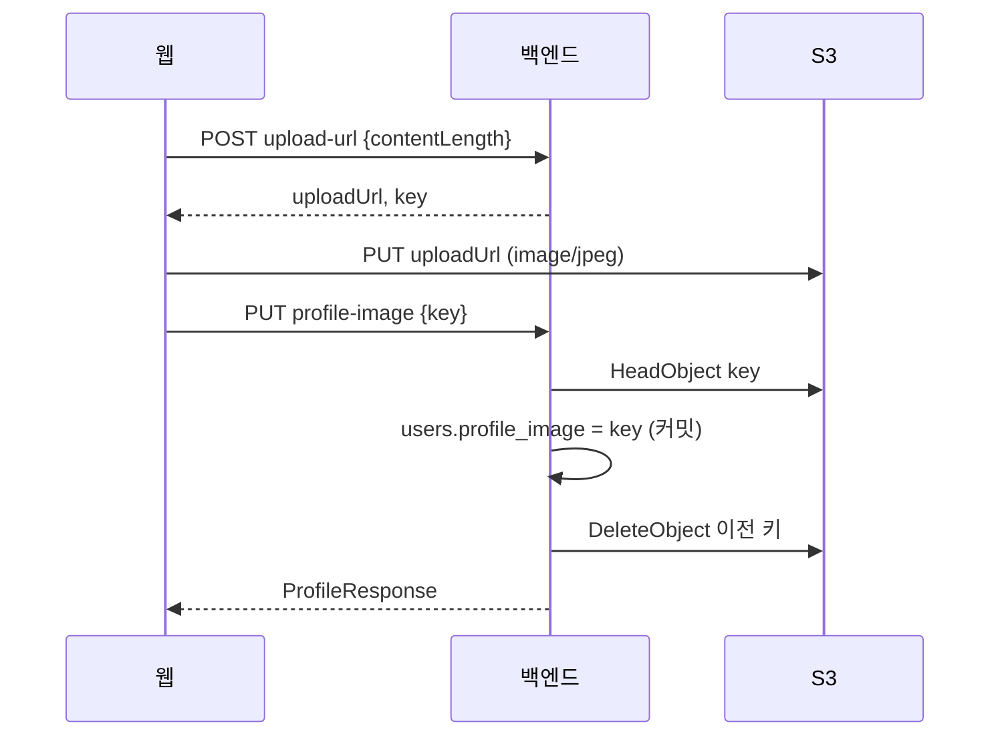

# BY-1035 프로필 사진 업로드 URL과 응답 필드 설계

- 티켓: BY-1035 (스토리 BY-1031)
- 선행: BY-1034 인프라(사진 버킷, CloudFront `/avatars/*`), BY-1032 위키 정책
- 후속: BY-1037 웹 업로드·표시, BY-1038 QA

## 목표

사용자가 프로필 사진을 올리고 바꾸고 되돌릴 수 있게 하고, 프로필·소셜룸·랭킹 응답에 사진 경로를 싣는다.

## 결정

| # | 항목 | 결정 |
|---|---|---|
| 1 | 올린 파일 확인 | `PUT` 때 S3 `HeadObject`로 존재·크기·형식을 확인한다. 업로드 주체에 `s3:GetObject`를 추가한다 |
| 2 | 의존성 | AWS SDK v2 `s3` 모듈 하나. 버전은 `software.amazon.awssdk:bom`으로 맞춘다 |
| 3 | 운영자 삭제 | 관리 API 없이 런북으로 한다 |
| 4 | 응답 주소 | `base-url + "/" + key`. `base-url` 기본값은 빈 문자열이라 지금은 상대 경로 `/avatars/...`다 |
| 5 | 이전 파일 | 사진을 바꾸거나 되돌리면 DB 커밋 뒤 바로 삭제한다 |
| 6 | API 모양 | 프로필 `PATCH`에 섞지 않고 사진 전용 경로(`PUT`·`DELETE`)로 나눈다 |

## API

세 경로 모두 새 엔드포인트라 기본 버전 `API-Version: 1`이고(ADR-0015 2026-09-22 갱신), 인증이 필요하다.

### `POST /api/users/me/profile-image/upload-url`

요청:

```json
{ "contentLength": 123456 }
```

응답 200:

```json
{
  "uploadUrl": "https://focus-makers-prod-avatars-821365066487.s3.ap-northeast-2.amazonaws.com/avatars/12/3f2a….jpg?X-Amz-…",
  "key": "avatars/12/3f2a….jpg",
  "expiresAt": "2026-10-28T10:05:00Z"
}
```

- `contentLength`가 1 미만이거나 1,048,576(1MB)을 넘으면 400 `VALIDATION_FAILED`다.
- 키는 `avatars/{userId}/{UUID}.jpg`로 서버가 만든다.
- 서명에 `Content-Type: image/jpeg`와 요청한 `Content-Length`를 넣는다. 브라우저는 같은 크기의 JPEG Blob을 그 헤더로 `PUT`해야 한다.
- URL 유효 시간은 5분이다.

### `PUT /api/users/me/profile-image`

요청:

```json
{ "key": "avatars/12/3f2a….jpg" }
```

응답 200: 바뀐 `ProfileResponse`.

400 `BAD_REQUEST`가 나는 경우:

- 키가 `avatars/{요청한 userId}/{UUID}.jpg` 형식이 아니다(남의 키 포함).
- S3에 파일이 없다.
- 파일 크기가 1MB를 넘거나 `Content-Type`이 `image/jpeg`가 아니다. 이때는 그 파일을 삭제하고 400을 돌려준다.

같은 키를 다시 보내면 아무것도 삭제하지 않고 200을 돌려준다.

### `DELETE /api/users/me/profile-image`

응답 200: 바뀐 `ProfileResponse`. 사진이 없어도 200이다.

## 처리 흐름



- 이전 파일 삭제는 DB 커밋 뒤에 한다. 삭제가 실패해도 요청은 성공으로 두고 경고 로그만 남긴다. 남은 파일은 어디서도 참조하지 않는다.
- S3 호출은 `ProfileImageStorage` 한 클래스가 맡는다(업로드 URL 발급, `HeadObject`, `DeleteObject`).

## 응답 필드

### 프로필

`ProfileResponse`에 `profileImageUrl`(nullable)을 추가한다. 레거시 v1 경로도 같은 레코드를 쓰므로 함께 실린다. 필드 추가라 기존 클라이언트는 영향이 없다.

### 소셜룸

- V31 마이그레이션으로 `room_participations.profile_image varchar`를 추가한다.
- 입장 경로 세 곳(`insertReservation`, `restoreFromGrace`, `refreshReservation`)에서 닉네임과 함께 사진 키를 복사한다.
- `RoomMember`에 `profileImageUrl`을 추가한다. 값은 입장할 때 복사한 키로 만든다. 방에 있는 동안 사진을 바꾸면 다음 입장부터 반영된다.
- 이전 파일을 바로 삭제하므로, 이미 방에 있는 사람들 화면에서는 엣지 캐시가 끝난 뒤(최대 1시간) 다음 입장 전까지 이니셜로 보인다.
- STOMP 명세가 바뀌므로 `websocket.html`을 고친다.

### 랭킹

- `StudySessionRankingQueries`의 닉네임 조인 쿼리에 `u.profile_image`를 추가하고, `RankingEntry`를 거쳐 `BoardEntry`, `BoardNeighbor`, `DayGroupRow`에 `profileImageUrl`을 싣는다.
- 랭킹 캐시 때문에 사진 변경은 최대 60초 늦게 반영된다.

## 설정과 인프라

| 설정 | 운영 | 개발 서버 | 로컬·테스트 |
|---|---|---|---|
| `app.profile-image.bucket` | `focus-makers-prod-avatars-821365066487` | `focus-makers-staging-avatars-821365066487` | 임의 값 |
| `app.profile-image.region` | `ap-northeast-2` | `ap-northeast-2` | `ap-northeast-2` |
| `app.profile-image.base-url` | 빈 문자열 | 빈 문자열 | 빈 문자열 |

- 자격 증명은 SDK 기본 체인으로 읽는다. 운영은 ECS 태스크 역할, 개발 서버는 EC2 인스턴스 역할, 로컬은 `AWS_PROFILE`이다.
- 운영 값은 ECS 태스크 정의 환경 변수로 넣는다. 태스크 정의는 infra 저장소가 관리하므로 배포 전에 infra 쪽 변경이 필요하다.
- infra 사진 버킷 정책의 업로드 주체 권한에 `s3:GetObject`를 추가한다. 스테이징 주체 ARN을 받으면 같은 PR에서 넣는다.
- 개발 서버 역할 정책에도 `s3:GetObject`가 필요하다. BE 팀원에게 추가로 요청한다.

## 운영자 삭제 런북

`docs/runbooks/profile-image-removal.md`를 추가한다.

1. db-shell로 운영 DB에 접속한다.
2. 아래 SQL을 트랜잭션 안에서 실행하고, 한 줄만 바뀌었는지와 삭제할 키를 확인한 뒤 커밋한다. `RETURNING`은 바뀐 뒤 값을 돌려주므로 지우기 전 키는 서브쿼리로 받는다.

   ```sql
   BEGIN;
   UPDATE users u SET profile_image = NULL
   FROM (SELECT id, profile_image FROM users WHERE id = :userId FOR UPDATE) old
   WHERE u.id = old.id
   RETURNING u.id, old.profile_image;
   COMMIT;
   ```
3. 나온 키 하나만 `aws s3 rm s3://<버킷>/<키>`로 삭제한다. `--recursive`는 쓰지 않는다.
4. 처리한 사용자 id와 시각을 신고 메일 스레드에 남긴다.

관리 API를 두지 않는 이유는 관리자 인증 체계가 없고, 새 엔드포인트가 공격 지점을 늘리기 때문이다. 신고가 잦아지면 BY-1039에서 다시 검토한다.

## ADR

ADR-0034에 같은 출처 경로로 서빙하는 이유, presigned PUT, 크기를 서명과 `HeadObject`로 두 번 확인하는 이유, 운영자 삭제를 런북으로 둔 이유를 남긴다.

## 범위 밖

- 탈퇴 시 사진 삭제: 탈퇴 기능이 아직 없다.
- 앱 안 신고: BY-1039.
- 이미지 리사이즈·형식 변환: 웹이 512px JPEG로 만들어 올린다(BY-1037).

## 테스트

- 단위 테스트
  - 키 소유 확인(본인 키, 남의 키, 형식이 틀린 키)
  - 크기 경계값(1,048,576 통과, 1,048,577 거부, 0 거부)
  - 사진 교체 시 이전 키 삭제, 같은 키 재전송 시 삭제하지 않음
  - 이전 파일 삭제 실패 시에도 성공
- 통합 테스트(Testcontainers, S3는 `@TestConfiguration`의 `@Primary` 대역)
  - 세 API의 성공·실패 응답
  - `ProfileResponse`, `RoomMember`, 랭킹 응답에 사진 경로가 실린다
- 서명 확인 테스트
  - 업로드 URL의 `X-Amz-SignedHeaders`에 `content-length`와 `content-type`이 들어 있다. 고정 자격 증명으로 네트워크 없이 확인한다.
